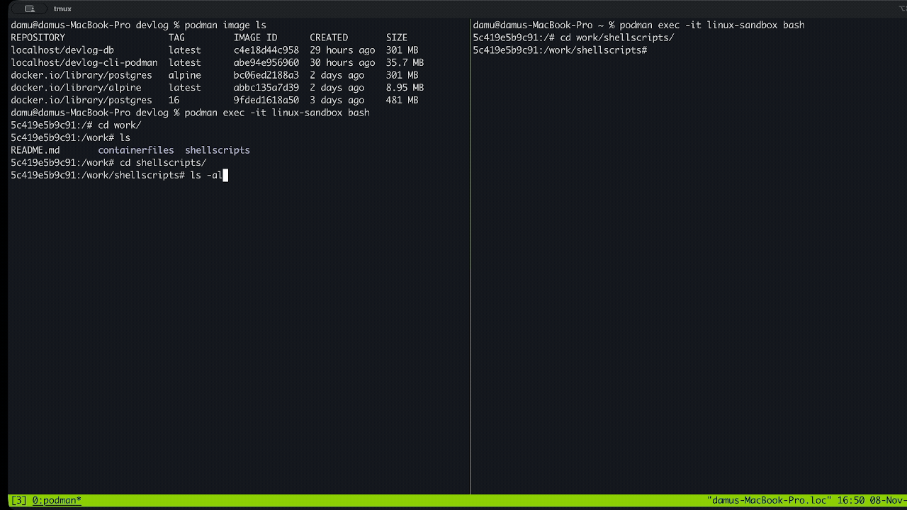

# DevLog

DevLog is a learning project for a small notes application built with Bash, PostgreSQL, and Age. It has an interactive shell client, a Bash HTTP backend, and a PostgreSQL schema. The application has been deployed and tested end to end on a local kind Kubernetes cluster.

## Demo



## Repository structure

```text
devlog/
├── README.md
├── docs/
│   |── demo.gif                    # Short animated preview
├── shellscripts/
│   ├── main.sh                     # Interactive client entry point
│   ├── cli.sh                      # Menu, HTTP client, local Age encryption
│   ├── backend.sh                  # HTTP listener and PostgreSQL writes
│   └── logs.sh                     # Logging helper
├── kind-k8s/
│   └── manifests/
│       ├── devlog-cli-dep.yaml     # Client workload and client PVC mount
│       ├── devlog-db-dep.yaml      # PostgreSQL workload and readiness probe
│       ├── devlog-db-pvc.yaml      # PostgreSQL persistent volume claim
│       ├── devlog-client-pvc.yaml  # Client persistent volume claim
│       ├── devlog-db-svc.yaml      # Internal PostgreSQL Service
│       └── notes.md               # Kubernetes implementation notes
└── containerfiles/
    ├── README.md                   # Container workflow notes
    ├── client/
    │   └── dockerfile              # Client image definition
    └── backend/
        ├── dockerfile              # PostgreSQL image definition
        ├── schema.sql              # Notes table schema
        └── ref.txt                 # Backend container notes
```

The shell scripts source sibling files by relative path, so run them from `shellscripts/` or the corresponding working directory inside the container.

## Current prototype

- The client provides an interactive menu and stores local note files encrypted with Age.
- The client sends note requests to the backend over HTTP.
- The backend listens on port `9090` and uses `psql` to write notes to PostgreSQL.
- `containerfiles/backend/schema.sql` defines the PostgreSQL notes table.

The client retrieval and edit flows are still being developed. Review [containerfiles/README.md](containerfiles/README.md) and the Dockerfiles for the current container setup.

## Kubernetes implementation

The Kubernetes implementation is complete for the current local learning project and has been exercised end to end on kind. The client sends note requests to the backend, and the backend writes them to PostgreSQL through the database Service.

- A client Deployment uses the locally built client image, resource requests and limits, and a PVC mounted for client files.
- A PostgreSQL Deployment uses a readiness probe and a PVC mounted at the PostgreSQL data directory.
- A `ClusterIP` Service named `devlog-db-svc` provides stable in-cluster discovery for PostgreSQL on port `5432`.
- Local images are loaded into the kind node and inspected with the container runtime tools.
- The backend connects to PostgreSQL using `DB_HOST=devlog-db-svc`; the client reaches the backend over `localhost:9090` while both scripts run in the client Pod.
- Hands-on implementation and debugging observations are recorded in [kind-k8s/manifests/notes.md](kind-k8s/manifests/notes.md).

Apply the manifests from the repository root with:

```sh
kubectl apply -f kind-k8s/manifests/devlog-db-pvc.yaml \
  -f kind-k8s/manifests/devlog-db-dep.yaml \
  -f kind-k8s/manifests/devlog-db-svc.yaml \
  -f kind-k8s/manifests/devlog-client-pvc.yaml \
  -f kind-k8s/manifests/devlog-cli-dep.yaml
```

The current setup is a local learning deployment. Credentials are still supplied directly in manifests/scripts, there is no Ingress, and the interactive client is run on demand in its Pod. Secrets, configuration management, and a repeatable deployment workflow can be added as a later hardening step.

## Requirements

For shell and container development, use Bash, Age, `curl`, `socat`, the PostgreSQL client (`psql`), and Podman or Docker. Kubernetes work uses `kubectl` and a local kind cluster; the images must be available to the kind node before applying workloads that use local images.
